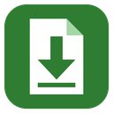

<p align="center">
  
</p>

<h1 align="center">Full Page PDF</h1>

<p align="center">
  <b>Save any web page as a PDF in one click. One long page that looks exactly like the screen, or classic A4/Letter pages.</b>
</p>

<p align="center">
  
  
  
</p>

---

**Full Page PDF** is a lightweight Chrome extension that turns the current tab into a PDF using Chrome's own rendering engine. Unlike *Print → Save as PDF*, it keeps the page **as you see it**: the desktop layout, background colors, images, and no awkward page breaks cutting through content.

## Features

- **One click.** Press the toolbar icon or use the right-click menu.
- **One long page.** The whole site goes on a single seamless PDF page, with no breaks in the middle of images or text.
- **Looks like the screen.** It uses screen CSS instead of the site's stripped-down print stylesheet.
- **Fixes `100vh` sections.** Full-screen hero blocks keep their real height instead of stretching across the PDF.
- **Lazy images load.** The page is auto-scrolled first, so `loading="lazy"` images show up.
- **Paged mode as well.** A4, A3, A5, Letter or Legal; portrait or landscape; margins; optional header and footer with page numbers.
- **Keeps the desktop layout.** In paged mode, content is scaled to the sheet width so the site doesn't switch to its mobile view.
- **Real, selectable text.** It produces a vector PDF with a tagged structure and bookmarks built from page headings.
- **Private.** Everything happens locally in your browser. No account, no servers, no tracking.
- **Tiny.** Plain JavaScript, zero dependencies, no build step.

## Installation

The extension isn't on the Chrome Web Store yet. To install it from source:

1. Download this repository (**Code → Download ZIP**) and unzip it into a permanent folder, or clone it:
   ```bash
   git clone https://github.com/Dimiart/pdf-add-on.git
   ```
2. Open `chrome://extensions`.
3. Turn on **Developer mode** (top-right toggle).
4. Click **Load unpacked** and select the folder that contains `manifest.json`.
5. Pin the extension: click the puzzle icon next to the address bar, then the pin next to **Full Page PDF**.

It also works in other Chromium browsers, such as Edge, Brave, Opera and Vivaldi.

## Usage

| Action | Result |
| --- | --- |
| Click the toolbar icon | Saves the current page to your Downloads folder |
| Right-click the page → **Save page as PDF** | Same as above |
| Right-click the icon → **Options** | Opens settings |

The badge on the icon shows the status: `…` while saving, `✓` when done, and `!` on error (details appear in a notification).

## Options

| Setting | Default | Description |
| --- | :---: | --- |
| One long page | ✅ | The whole page on a single sheet. Turn off to split it into pages |
| Look as on screen | ✅ | Use screen styles instead of the print stylesheet |
| Print backgrounds | ✅ | Include background colors and images |
| Load lazy images | ✅ | Scroll through the page before saving |
| Ask where to save | ⬜ | Show the *Save as* dialog each time |
| Paper size | A4 | A4, A3, A5, Letter or Legal (paged mode) |
| Margins | Normal | None, Narrow, Normal or Wide (paged mode) |
| Landscape | ⬜ | Paged mode only |
| Keep desktop layout | ✅ | Fit the window width onto the sheet (paged mode) |
| Header and footer | ⬜ | Date, title, URL and page numbers (paged mode) |

## How it works

The extension attaches to the tab through the [`chrome.debugger`](https://developer.chrome.com/docs/extensions/reference/api/debugger) API and calls the DevTools Protocol method [`Page.printToPDF`](https://chromedevtools.github.io/devtools-protocol/tot/Page/#method-printToPDF). That's the same engine Chrome uses for printing, but with full control over page size, scale and media type.

In single-page mode it measures the full document height and sets a custom paper size to match. It then checks the resulting PDF, and if anything spilled onto a second page it enlarges the sheet and renders again. Pages taller than Chrome's limit (about 200 inches) are scaled down to fit.

## Permissions

| Permission | Why it is needed |
| --- | --- |
| `debugger` | Run `Page.printToPDF` and emulate screen media |
| `activeTab`, `scripting` | Scroll the current page to load lazy images |
| `downloads` | Save the generated PDF |
| `storage` | Remember your settings |
| `contextMenus` | The *Save page as PDF* right-click item |
| `notifications` | Show an error message if saving fails |

## Good to know

- While saving, Chrome briefly shows the banner *"Full Page PDF started debugging this browser"*. That is expected: Chrome shows it whenever the DevTools Protocol is used, and it disappears right away.
- Saving won't work while DevTools (F12) is open on the same tab.
- Chrome blocks extensions on internal pages (`chrome://…`, the New Tab page) and on the Chrome Web Store.
- To save local `file://` pages, open the extension's **Details** and turn on **Allow access to file URLs**.
- If the tab is already showing a PDF file, the original file is downloaded.

## Project structure

```
├── manifest.json   # Extension manifest (MV3)
├── background.js   # Service worker: capture logic
├── settings.js     # Default settings shared across the extension
├── options.html    # Options page
├── options.js
└── icons/
```

## Contributing

Issues and pull requests are welcome. If a page doesn't save correctly, please open an issue with its URL and the settings you used.

## License

[MIT](LICENSE)
